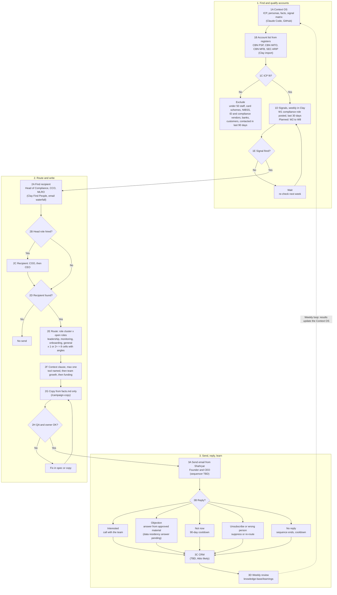

# GTM system: Asterisk Nigeria outbound

Status: v1, 2026-11-14. A text and Mermaid version of the system map. The Mermaid flowchart is the system map; no Miro board (owner decision, 2026-11-19).
Built from: [signal-matrix.md](../icp/signal-matrix.md), [W1 workflow spec](../../output/campaigns/nigeria-hiring-compliance-roles/workflow-spec.md), [icp.md](../icp/icp.md), [facts.md](../messaging/facts.md).

## How it works

### Phase 1: Find and qualify accounts
1. **Context OS** (this repo, Claude Code, GitHub): ICP, personas, positioning, facts, signal matrix.
2. **Account list from registers**: CBN PSP register, CBN IMTO list, CBN MFB list, SEC ARIP circulars, loaded into Clay as the closed list for priority cells A1, B1, C1, D1.
3. **ICP filter**: 50+ employees on LinkedIn; drop card schemes, NIBSS, super-agent-only, ID and compliance vendors, deposit money banks, customers, contacts from the last 90 days.
4. **Signals** (Clay, weekly): W1 is live in spec (compliance role posted in Nigeria in the last 30 days). Planned: W2 new compliance leader, W3 new CBN licence, W4 new IMTO or SEC ARIP licensee, W5 CBN circular, W6 product or market launch, W7 new partner bank, W8 named accounts.

### Phase 2: Route and write
5. **Recipient found?** Head of Compliance / CCO / MLRO, or COO then CEO when the head role is the one being hired. No recipient means no send.
6. **Route** (W1): role cluster (leadership, monitoring, onboarding, general) x open roles (1, 2+) = 8 cells, each with an approved angle.
7. **Context clause**: at most one per email: tool named in the job post, then team growth, then funding.
8. **Copy** (/campaign-copy): only claims in facts.md; anything else stays a `{{placeholder}}`.
9. **QA** (/campaign-qa) before anything is sent. Owner approval required.

### Phase 3: Send, reply, learn
10. **Send**: email from Shahryar Hasnani, Founder & CEO. Sequencer: **{{TBD}}**.
11. **Replies**:
    - Interested: call with the team (the primary CTA).
    - Objection: answer from approved material. **The data residency answer is still pending** (engineering and legal).
    - Not now: 90-day cooldown, re-enters on a new signal.
    - Unsubscribe or wrong person: suppress, or re-route to the right person.
12. **CRM**: **{{TBD}}**. Asterisk's website form already feeds Attio (privacy page), so Attio is the likely candidate. Confirm.
13. **Learn**: weekly review of results in knowledge-base/learnings/, which updates the Context OS, the signal matrix and the tracker.

## Open items
- Sequencer and CRM for outbound: not yet chosen.
- Data residency answer for the objection branch.

## Flowchart

